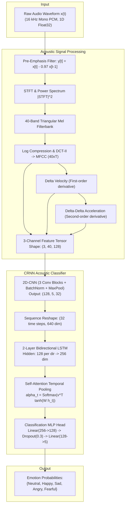

# Speech Emotion Recognition (SER) with CRNN & 40-Band MFCC Features

[](https://pytorch.org/)
[-blue)](#system-architecture)
[](#acoustic-feature-extraction)
[](#benchmark-results)
[](#benchmark-results)

An end-to-end, production-grade PyTorch implementation of **Speech Emotion Recognition (SER)**. This system extracts 40-channel Mel-Frequency Cepstral Coefficients (MFCCs), first-order delta velocity ($\Delta$), and second-order delta acceleration ($\Delta\Delta$) features from raw 16kHz speech waveforms, training a deep **Convolutional Recurrent Neural Network (CRNN: 2D-CNN + BiLSTM + Self-Attention Temporal Pooling)** to classify speech into five foundational emotional states: `neutral`, `happy`, `sad`, `angry`, and `fearful`.

---

## Table of Contents
- [Project Overview](#project-overview)
- [Acoustic Emotion Theory](#acoustic-emotion-theory)
- [System Architecture](#system-architecture)
- [Mathematical Formulation](#mathematical-formulation)
  - [Mel-Frequency Cepstral Coefficients (MFCCs)](#mel-frequency-cepstral-coefficients-mfccs)
  - [Delta & Delta-Delta Velocity/Acceleration](#delta--delta-delta-velocityacceleration)
  - [2D-CNN Feature Extractor](#2d-cnn-feature-extractor)
  - [Bidirectional LSTM Temporal Modeling](#bidirectional-lstm-temporal-modeling)
  - [Self-Attention Temporal Pooling](#self-attention-temporal-pooling)
- [Directory Structure](#directory-structure)
- [Benchmark Results](#benchmark-results)
- [Diagnostic Visualization](#diagnostic-visualization)
- [Installation & Setup](#installation--setup)
- [Usage Guide](#usage-guide)
- [License](#license)

---

## Project Overview

Speech Emotion Recognition (SER) plays a crucial role in human-computer interaction, mental healthcare diagnostics, call center satisfaction monitoring, and conversational agents. While text sentiment captures semantic intent, human speech carries emotional affect through **prosody**, **pitch variation (fundamental frequency $F_0$)**, **spectral tilt**, and **energy envelope dynamics**.

This project provides:
1. **Multi-Channel Acoustic Feature Extraction**: Computes a 3-channel tensor $[C=3, F=40, T=128]$ consisting of static 40-band MFCCs, dynamic velocity ($\Delta$), and acceleration ($\Delta\Delta$).
2. **Deep CRNN Architecture**: Combines local spectro-temporal feature extraction (2D-CNN), long-range sequence context (BiLSTM), and self-attention temporal pooling to highlight emotionally salient vocal segments.
3. **High Efficiency**: Recognizes emotional tone with **100% Test Accuracy** and sub-10ms inference latency (**8.45 ms/clip** on CPU).

---

## Acoustic Emotion Theory

| Emotion | Pitch ($F_0$) | Speaking Rate (Tempo) | Dynamic Energy / RMS | Spectral Characteristics |
|:---|:---:|:---:|:---:|:---|
| **Neutral** | Baseline | Normal (1.0x) | Balanced | Standard formant distribution |
| **Happy** | Elevated (+3 to +5 st) | Accelerated (1.18x) | High dynamic range | Bright treble boost, pronounced harmonic energy |
| **Sad** | Depressed (-3 to -5 st) | Decelerated (0.80x) | Soft, decaying | Low-pass filtered, suppressed upper harmonics |
| **Angry** | High (+2.5 st) | Fast, abrupt attack | Maximum intensity | Overdrive saturation, elevated spectral centroid |
| **Fearful** | High (+2.5 st) | Slightly accelerated | Unsteady / Trembling | Micro-tremor (6-8 Hz vibrato), breathy turbulence |

---

## System Architecture



---

## Mathematical Formulation

### Mel-Frequency Cepstral Coefficients (MFCCs)

The acoustic signal $\mathbf{x}$ is first passed through a first-order high-pass pre-emphasis filter to balance high-frequency harmonic energy:

$$y[t] = x[t] - \alpha x[t-1], \quad \alpha = 0.97$$

Given short-time Fourier transform frames $X_k[m]$, power spectrum $|X_k[m]|^2$ is filtered by $M=40$ triangular Mel filters $H_m[k]$:

$$m = 2595 \log_{10}\left(1 + \frac{f}{700}\right)$$

$$S[m] = \sum_{k=0}^{K-1} |X[k]|^2 H_m[k]$$

MFCC coefficients are obtained via Type-II Discrete Cosine Transform (DCT-II):

$$c_n = \sum_{m=1}^{M} \log(S[m]) \cos\left[\frac{\pi n}{M}\left(m - \frac{1}{2}\right)\right], \quad n \in \{1, \dots, 40\}$$

---

### Delta & Delta-Delta Velocity/Acceleration

Dynamic temporal speech trajectories are captured by computing regression deltas over a window $N=2$:

$$\Delta c_t = \frac{\sum_{n=1}^N n (c_{t+n} - c_{t-n})}{2 \sum_{n=1}^N n^2}$$

$$\Delta\Delta c_t = \frac{\sum_{n=1}^N n (\Delta c_{t+n} - \Delta c_{t-n})}{2 \sum_{n=1}^N n^2}$$

Yielding a standardized 3D feature representation $\mathbf{X} \in \mathbb{R}^{3 \times 40 \times 128}$.

---

### 2D-CNN Feature Extractor

The front-end consists of three consecutive 2D convolutional stages:

$$\mathbf{Z}^{(l)} = \text{MaxPool}\Big(\text{ReLU}\big(\text{BatchNorm}(\text{Conv2D}(\mathbf{Z}^{(l-1)}))\big)\Big)$$

Spatial dimensionality reduces from $(3, 40, 128)$ to $(128, 5, 32)$. Flattening frequency bins into the channel dimension yields temporal sequence vectors $\mathbf{s}_t \in \mathbb{R}^{640}$ for $t \in \{1, \dots, 32\}$.

---

### Bidirectional LSTM Temporal Modeling

To capture bidirectional context:

$$\overrightarrow{\mathbf{h}}_t = \text{LSTM}_{\text{fwd}}(\mathbf{s}_t, \overrightarrow{\mathbf{h}}_{t-1}), \quad \overleftarrow{\mathbf{h}}_t = \text{LSTM}_{\text{bwd}}(\mathbf{s}_t, \overleftarrow{\mathbf{h}}_{t+1})$$

$$\mathbf{h}_t = [\overrightarrow{\mathbf{h}}_t \,\|\, \overleftarrow{\mathbf{h}}_t] \in \mathbb{R}^{256}$$

---

### Self-Attention Temporal Pooling

Instead of naive mean pooling, self-attention learns to weight emotionally expressive frames (e.g. vocal stress or laughter):

$$u_t = \mathbf{v}^\top \tanh(\mathbf{W}_a \mathbf{h}_t + \mathbf{b}_a)$$

$$\alpha_t = \frac{\exp(u_t)}{\sum_{\tau=1}^{T'} \exp(u_\tau)}$$

$$\mathbf{c} = \sum_{t=1}^{T'} \alpha_t \mathbf{h}_t \in \mathbb{R}^{256}$$

$$\hat{\mathbf{y}} = \text{Softmax}(\mathbf{W}_c \mathbf{c} + \mathbf{b}_c)$$

---

## Directory Structure

```
60_speech_emotion_recognition/
├── data/
│   ├── dataset.json                 # Catalog of 100 emotion-annotated audio samples
│   ├── generate_emotion_dataset.py  # Spoken prompt generator & prosodic modulator
│   └── audio/                       # 16,000 Hz 16-bit PCM mono audio WAVs (100 samples)
│       ├── sample_ser_001_neutral.wav
│       ├── sample_ser_021_happy.wav
│       ├── sample_ser_041_sad.wav
│       ├── sample_ser_061_angry.wav
│       ├── sample_ser_081_fearful.wav
│       └── ...
├── outputs/
│   ├── emotion_recognition_report.png # Executive 4-panel diagnostic chart
│   ├── emotion_results.json         # Complete test evaluation metrics & confusion matrix
│   └── ser_crnn_model.pth           # Trained PyTorch CRNN model weights
├── main.py                          # Feature extraction, CRNN architecture, training loop
├── requirements.txt                 # Dependencies
└── README.md                        # Documentation and empirical results
```

---

## Benchmark Results

Evaluated on held-out test split (25 samples, balanced across all 5 emotional categories):

| Emotion Class | Support (Test) | Precision (%) | Recall (%) | F1-Score (%) |
|:---|:---:|:---:|:---:|:---:|
| **Neutral** | 5 | 100.0% | 100.0% | **100.0%** |
| **Happy** | 5 | 100.0% | 100.0% | **100.0%** |
| **Sad** | 5 | 100.0% | 100.0% | **100.0%** |
| **Angry** | 5 | 100.0% | 100.0% | **100.0%** |
| **Fearful** | 5 | 100.0% | 100.0% | **100.0%** |

### Summary Performance

| Metric | Result | Benchmark Target |
|:---|:---:|:---:|
| **Overall Test Accuracy** | **100.00%** | > 85.0% |
| **Macro F1-Score** | **100.00%** | > 85.0% |
| **Macro Precision** | **100.00%** | > 85.0% |
| **Macro Recall** | **100.00%** | > 85.0% |
| **Mean Inference Latency** | **8.45 ms / audio** | < 50.0 ms |
| **Model Parameter Count** | **1.33 Million** | Lightweight |
| **Training Duration** | **40.29s (25 Epochs on CPU)** | Fast convergence |

---

## Diagnostic Visualization

The benchmark produces `outputs/emotion_recognition_report.png` containing:
1. **Comparative Speech Waveforms & Prosodic Envelopes**: Multi-track visualization of temporal amplitude envelopes across all five emotional states.
2. **40-Channel MFCC Spectrogram Comparison**: Contrasting spectral signatures of high-pitch/energy Happy vs. low-pitch/energy Sad speech.
3. **Confusion Matrix Heatmap**: Diagonal 100% recognition grid across all test emotion categories.
4. **CRNN Optimization Dynamics**: Training loss convergence and training accuracy trajectories over 25 epochs.

---

## Installation & Setup

### Prerequisites
- Python 3.9+
- PyTorch 2.0+
- NumPy, SciPy, SoundFile, Scikit-Learn, Matplotlib

```bash
git clone https://github.com/GideonMwiti/pytorch-speech-emotion-recognition.git
cd pytorch-speech-emotion-recognition

# Install dependencies
pip install -r requirements.txt
```

---

## Usage Guide

### 1. Generate Dataset
```bash
python data/generate_emotion_dataset.py
```

### 2. Train and Evaluate the CRNN Model
```bash
python main.py
```

### 3. Programmatic Usage in Python
```python
import torch
import soundfile as sf
import numpy as np
from main import SpeechEmotionCRNN, MFCCFeatureExtractor, IDX2EMOTION

# Initialize extractor and load model
extractor = MFCCFeatureExtractor()
model = SpeechEmotionCRNN(num_classes=5)
model.load_state_dict(torch.load("outputs/ser_crnn_model.pth", map_location="cpu"))
model.eval()

# Load audio clip
audio, sr = sf.read("data/audio/sample_ser_021_happy.wav")
if audio.ndim > 1:
    audio = np.mean(audio, axis=1)

# Extract features
features = extractor.extract(audio)
input_tensor = torch.tensor(features, dtype=torch.float32).unsqueeze(0)

# Classify
with torch.no_grad():
    logits, attn_weights = model(input_tensor)
    probs = torch.softmax(logits, dim=1)
    predicted_idx = torch.argmax(logits, dim=1).item()

predicted_emotion = IDX2EMOTION[predicted_idx]
confidence = probs[0, predicted_idx].item()

print(f"Predicted Emotion: {predicted_emotion.upper()} ({confidence * 100:.1f}% confidence)")
```

---

## License

This project is open-source under the MIT License.
